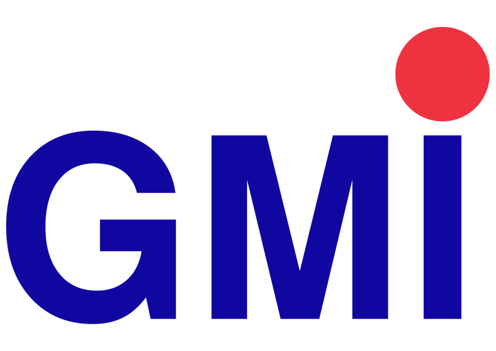

# Light and dark themes

The timetable uses a Calagopus-inspired neutral panel interface in both themes. Light mode has a soft grey canvas with white surfaces; dark mode uses the neutral Mantine palette used by the Calagopus panel. The layout is identical in both themes.

## Palette

### Light

| Token            | Hex       | Role                              |
| ---------------- | --------- | --------------------------------- |
| `--canvas`       | `#f0eff0` | Page background                   |
| `--surface`      | `#ffffff` | Cards, planner, dialogs           |
| `--surface-muted`| `#f8f9fa` | Rail, search fields, inset panels |
| `--ink`          | `#1a1b1e` | Primary text                      |
| `--muted`        | `#5c5f66` | Secondary text                    |
| `--line`         | `#dee2e6` | Borders and dividers              |
| `--accent`       | `#1971c2` | Primary buttons and active states |
| `--accent-text`  | `#1864ab` | Links and accent text             |
| `--accent-soft`  | `#e7f5ff` | Tints and selected states         |
| `--accent-line`  | `#a5d8ff` | Accent borders                    |

### Dark

| Token            | Hex       | Role                              |
| ---------------- | --------- | --------------------------------- |
| `--canvas`       | `#242424` | Page background                   |
| `--surface`      | `#2e2e2e` | Cards, planner, dialogs           |
| `--surface-muted`| `#1f1f1f` | Rail, search fields, top bar      |
| `--ink`          | `#c9c9c9` | Primary text                      |
| `--muted`        | `#b8b8b8` | Secondary text                    |
| `--line`         | `#424242` | Borders and dividers              |
| `--accent`       | `#1971c2` | Primary buttons and active states |
| `--accent-hover` | `#1864ab` | Primary button hover              |
| `--accent-text`  | `#4dabf7` | Links and accent text             |
| `--accent-soft`  | `#4dabf71f` | Tints and selected states       |
| `--accent-line`  | `#4dabf766` | Accent borders                  |
| `--warning-text` | `#ffd43b` | Warning badges                    |
| `--warning-soft` | `#ffd43b14` | Warning backgrounds             |

`#828282` is the palette's usual dimmed text, but it reaches only about 4.03:1 on `#242424`. The app uses `#b8b8b8` for muted text so axe WCAG AA checks pass.

```css
:root[data-theme='dark'] {
  color-scheme: dark;
  --canvas: #242424;
  --surface: #2e2e2e;
  --surface-muted: #1f1f1f;
  --ink: #c9c9c9;
  --muted: #b8b8b8;
  --line: #424242;
  --accent: #1971c2;
  --accent-hover: #1864ab;
  --accent-text: #4dabf7;
  --accent-soft: #4dabf71f;
  --accent-line: #4dabf766;
}
```

## Logo

The transparent `gmi-logo.png` is used in both themes at its original colours. The blue mark and red dot are never recoloured. In dark mode a layered white glow adds a soft halo against `#1f1f1f` and gently pulses:

```html
<a class="wordmark" href="./" aria-label="GMI Student Timetable home">
  
  <span class="wordmark-label">Student timetable</span>
</a>
```

```css
.wordmark-logo {
  display: block;
  height: 38px;
  width: auto;
}
:root[data-theme='dark'] .wordmark-logo {
  filter: drop-shadow(0 0 2px rgb(255 255 255 / 60%)) drop-shadow(0 0 9px rgb(255 255 255 / 34%))
    drop-shadow(0 0 20px rgb(255 255 255 / 16%));
  animation: logo-glow 5s ease-in-out infinite;
}
@keyframes logo-glow {
  0%,
  100% {
    filter: drop-shadow(0 0 2px rgb(255 255 255 / 60%)) drop-shadow(0 0 9px rgb(255 255 255 / 34%))
      drop-shadow(0 0 20px rgb(255 255 255 / 16%));
  }
  50% {
    filter: drop-shadow(0 0 3px rgb(255 255 255 / 74%)) drop-shadow(0 0 13px rgb(255 255 255 / 48%))
      drop-shadow(0 0 30px rgb(255 255 255 / 26%));
  }
}
```

Reduced-motion preferences stop the pulse after a single frame; the static halo remains.

## Components

- The top bar is white in light mode and `#1f1f1f` in dark mode. Icon buttons use the raised surface with a visible border, and the info icon uses a blue tint.
- The rail uses `--surface-muted`; cards and the planner use `--surface`.
- Lesson cards use three subtle tones: blue, neutral and warm. Dark mode uses `#26313a`, `#2a2a2a` and `#302b20` with matching borders.
- Active days, primary buttons and selected controls use `#1971c2` with white text. Links and accent text use `#1864ab` in light mode and `#4dabf7` in dark mode.
- Header actions are icon-only, in order: theme, accessibility, blue info and upload. Their accessible labels remain “Switch to dark/light theme”, “Accessibility preferences”, “Timetable information and status” and “Open timetable file”.
- The Browse trigger uses a small CSS/SVG cube with a pulsing glow: green for Class and red for Lecturer. Dark mode uses brighter cube colours. The subtitle is the current mode; the picker heading is `Find a Class` or `Find a Lecturer`.
- The planner date range is a single nowrap line between the previous and next week arrows, with **Today** selecting the current date. The date control remains clickable for the native picker. On desktop it keeps a fixed width so the arrows do not move.
- On mobile, the source revision is nested inside the Browse bar and uses the dark surface and border. The bottom cookie notice and privacy link inherit the muted text colours.

## Notes

- The `theme-color` meta tag switches between `#ffffff` and `#1f1f1f` to match the top bar.
- The theme is applied before first paint by `theme-boot.js`.
- Focus outlines use `#1c7ed6` in light mode and `#4dabf7` in dark mode.
- The high-contrast preference strengthens borders and text colours in both themes.
